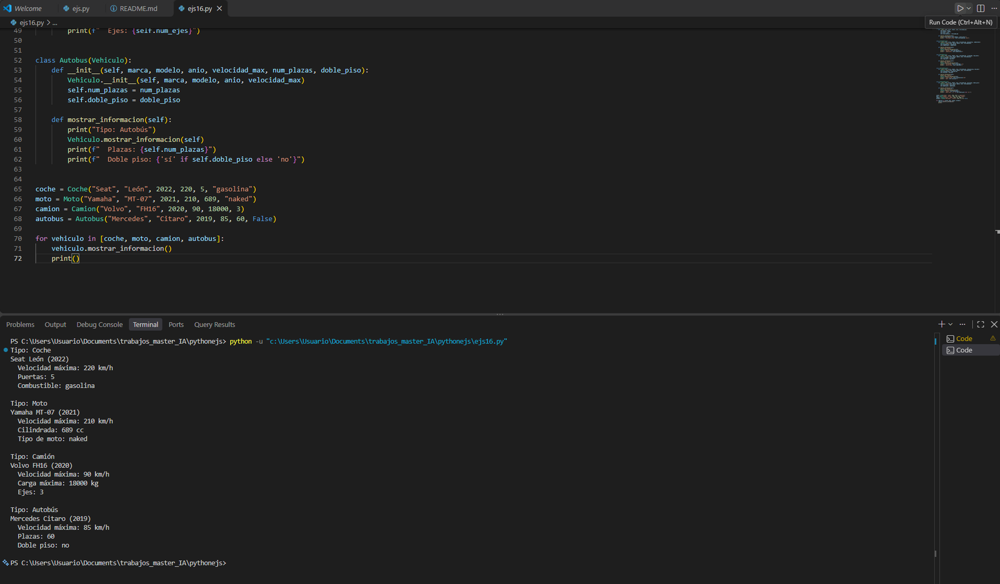
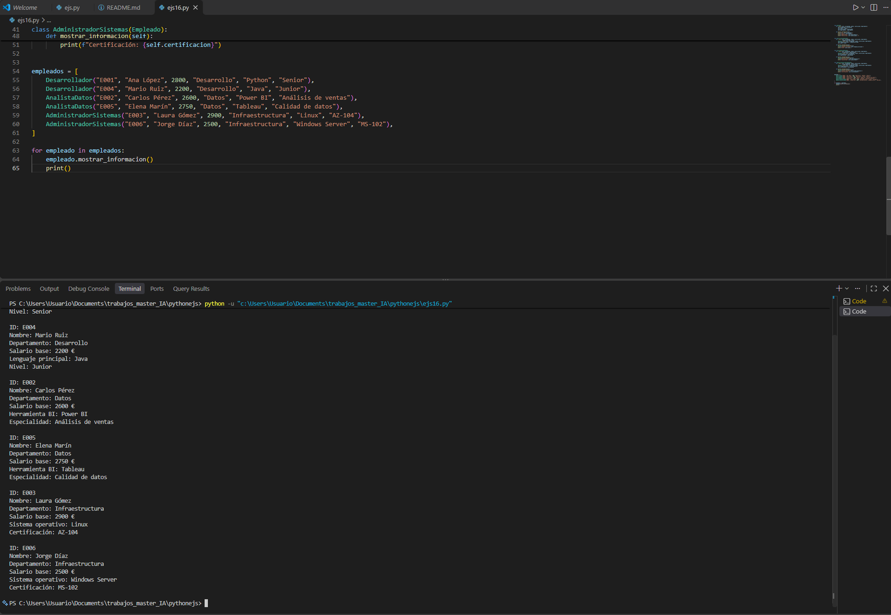
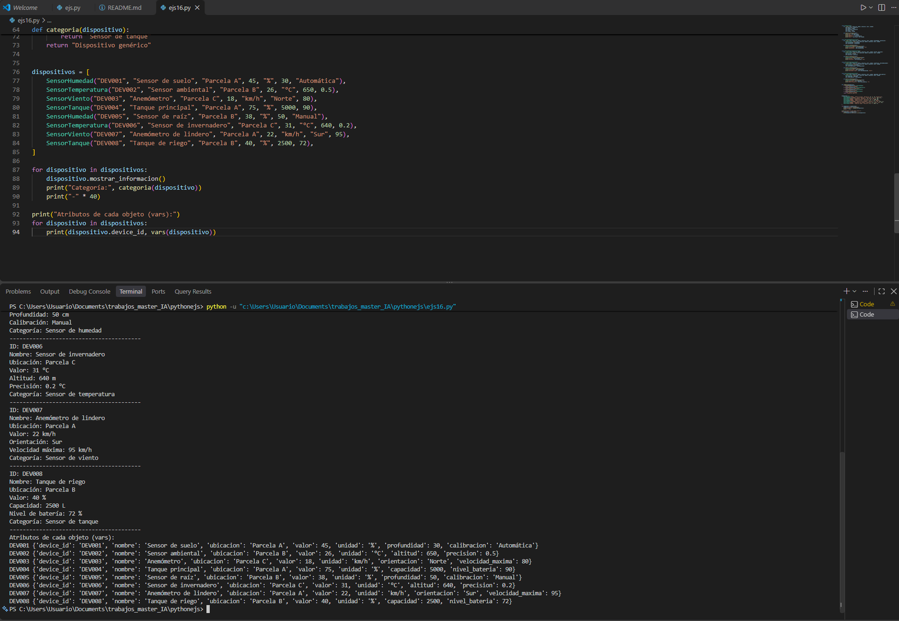
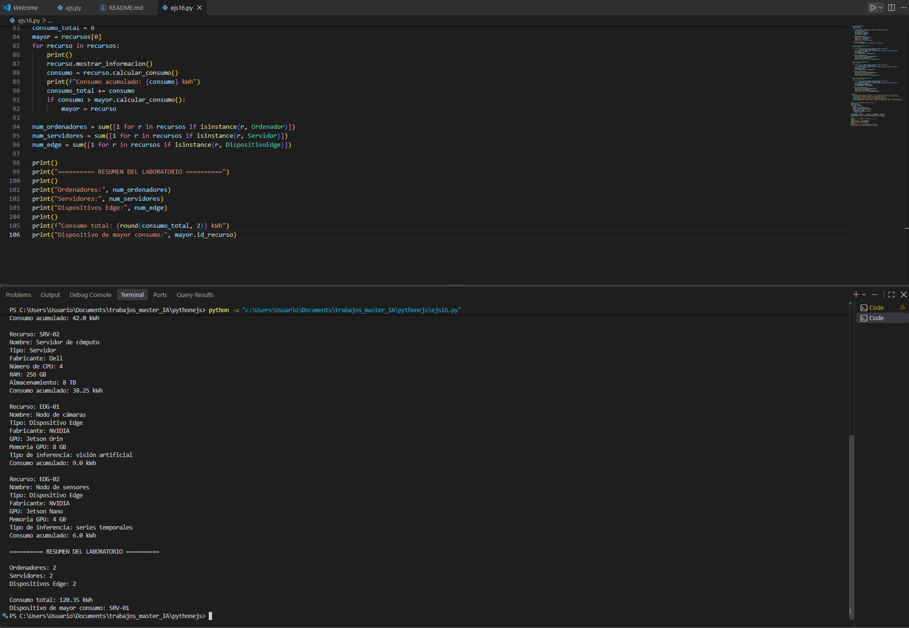
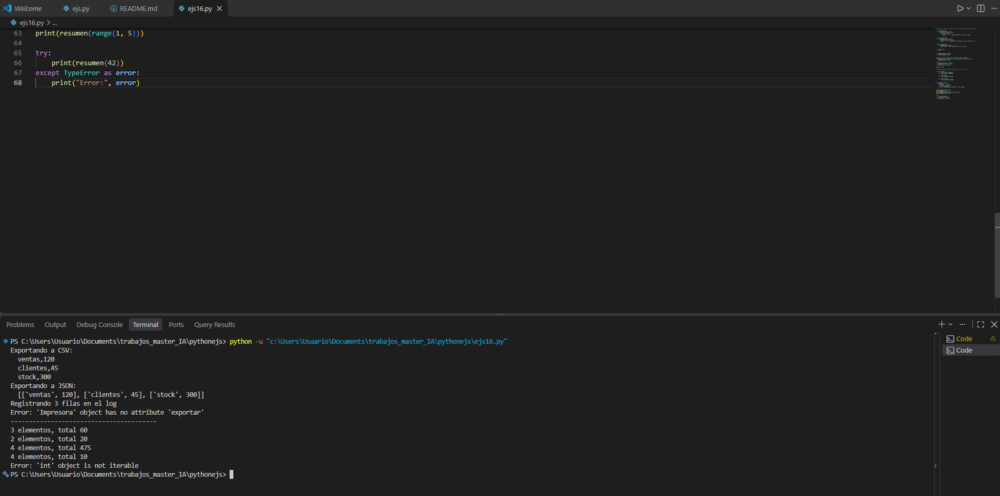
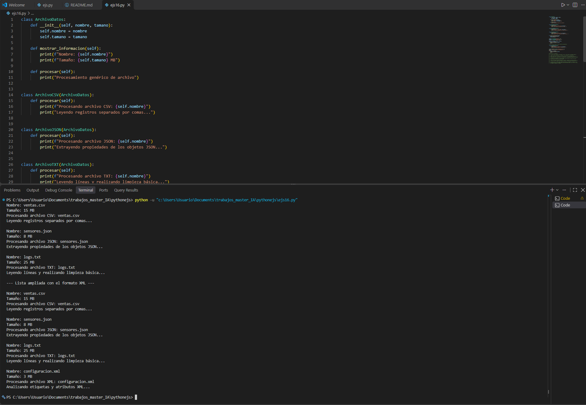
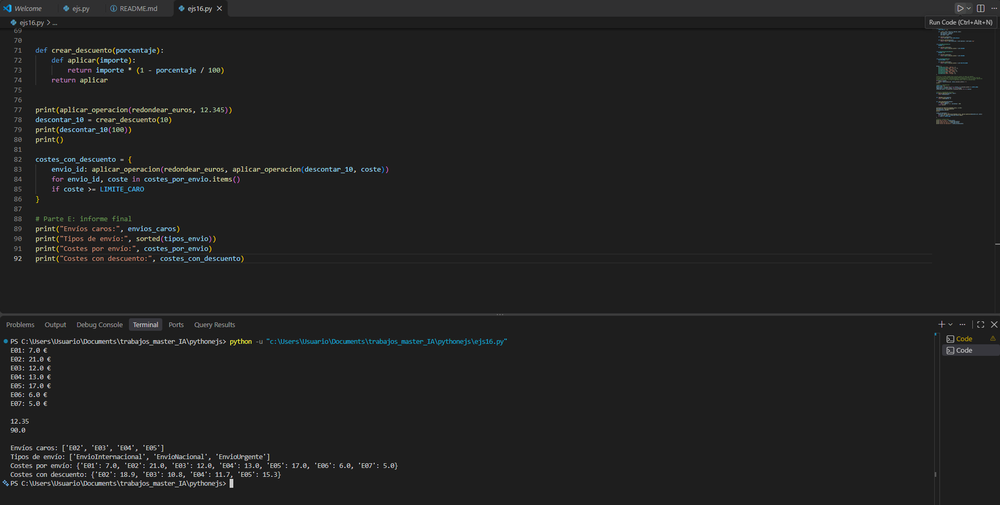
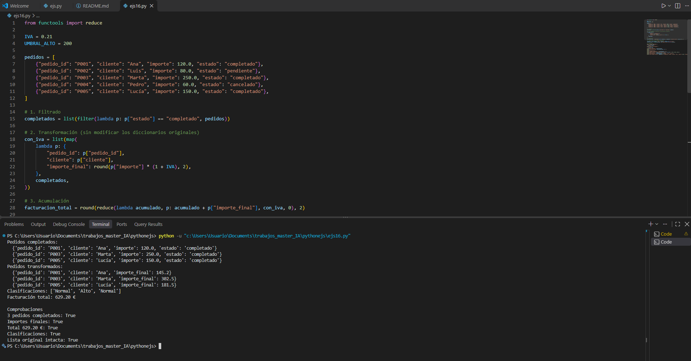
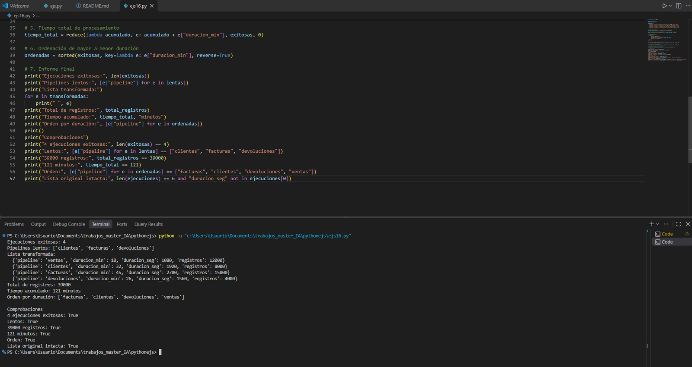

# Python Big Data Engineering

Clases 20 y 21: herencia, polimorfismo, comprehensions y programación funcional

Álvaro García-Quismondo Lizana  
Máster en IA, módulo de Big Data  
12 de noviembre de 2026

## 1. Objeto de la entrega

Este documento recoge la ejecución de los ejercicios de las clases 20 y 21 del módulo de Big Data. Cada apartado incluye una descripción breve, el código del script y la captura de su ejecución en Visual Studio Code. La clase 20 trata la herencia simple y el polimorfismo; la clase 21 combina herencia con comprehensions y programación funcional.

En las capturas el archivo abierto se llama ejs16.py porque cada script se pegó y ejecutó en un mismo archivo de trabajo. Cada script conserva su propio nombre en la carpeta de scripts. En algunas capturas el editor muestra solo parte del código y el terminal solo el final de la salida; el código completo figura siempre en el listado que las precede y, en los ejercicios con salida larga, la salida completa se incluye debajo de la captura.

## 2. Entorno y organización

Python 3.14 (64 bits), Visual Studio Code y PowerShell en Windows 11. Los scripts solo usan la biblioteca estándar.

En la clase 20 las subclases llaman a la superclase por su nombre (por ejemplo, `Vehiculo.__init__(self, ...)`), porque el ejercicio P4 prohíbe expresamente `super()`. En la clase 21, donde el ejercicio P1 lo exige, se usa `super()`.

Estructura de la carpeta de scripts:

```
python_big_data_engineering/
├── clase_20_herencia_polimorfismo/
│   ├── ejercicio_1_vehiculos.py
│   ├── ejercicio_p1_empleados.py
│   ├── ejercicio_p2_iot.py
│   ├── ejercicio_p3_laboratorio.py
│   ├── ejercicio_2_duck_typing.py
│   └── ejercicio_p4_archivos.py
└── clase_21_comprehensions_funcional/
    ├── ejercicio_p1_envios.py
    ├── ejercicio_p2_pedidos.py
    └── ejercicio_p3_pipelines.py
```

## 3. Clase 20. Herencia y polimorfismo

### Ejercicio 1. Jerarquía de vehículos

Superclase Vehiculo con los atributos comunes (marca, modelo, año y velocidad máxima) y cuatro subclases, Coche, Moto, Camion y Autobus, con atributos propios. Se crea un objeto de cada subclase y se muestra su información.

Script: `ejercicio_1_vehiculos.py`

```python
class Vehiculo:
    def __init__(self, marca, modelo, anio, velocidad_max):
        self.marca = marca
        self.modelo = modelo
        self.anio = anio
        self.velocidad_max = velocidad_max

    def mostrar_informacion(self):
        print(f"{self.marca} {self.modelo} ({self.anio})")
        print(f"  Velocidad máxima: {self.velocidad_max} km/h")


class Coche(Vehiculo):
    def __init__(self, marca, modelo, anio, velocidad_max, num_puertas, combustible):
        Vehiculo.__init__(self, marca, modelo, anio, velocidad_max)
        self.num_puertas = num_puertas
        self.combustible = combustible

    def mostrar_informacion(self):
        print("Tipo: Coche")
        Vehiculo.mostrar_informacion(self)
        print(f"  Puertas: {self.num_puertas}")
        print(f"  Combustible: {self.combustible}")


class Moto(Vehiculo):
    def __init__(self, marca, modelo, anio, velocidad_max, cilindrada, tipo_moto):
        Vehiculo.__init__(self, marca, modelo, anio, velocidad_max)
        self.cilindrada = cilindrada
        self.tipo_moto = tipo_moto

    def mostrar_informacion(self):
        print("Tipo: Moto")
        Vehiculo.mostrar_informacion(self)
        print(f"  Cilindrada: {self.cilindrada} cc")
        print(f"  Tipo de moto: {self.tipo_moto}")


class Camion(Vehiculo):
    def __init__(self, marca, modelo, anio, velocidad_max, carga_max_kg, num_ejes):
        Vehiculo.__init__(self, marca, modelo, anio, velocidad_max)
        self.carga_max_kg = carga_max_kg
        self.num_ejes = num_ejes

    def mostrar_informacion(self):
        print("Tipo: Camión")
        Vehiculo.mostrar_informacion(self)
        print(f"  Carga máxima: {self.carga_max_kg} kg")
        print(f"  Ejes: {self.num_ejes}")


class Autobus(Vehiculo):
    def __init__(self, marca, modelo, anio, velocidad_max, num_plazas, doble_piso):
        Vehiculo.__init__(self, marca, modelo, anio, velocidad_max)
        self.num_plazas = num_plazas
        self.doble_piso = doble_piso

    def mostrar_informacion(self):
        print("Tipo: Autobús")
        Vehiculo.mostrar_informacion(self)
        print(f"  Plazas: {self.num_plazas}")
        print(f"  Doble piso: {'sí' if self.doble_piso else 'no'}")


coche = Coche("Seat", "León", 2022, 220, 5, "gasolina")
moto = Moto("Yamaha", "MT-07", 2021, 210, 689, "naked")
camion = Camion("Volvo", "FH16", 2020, 90, 18000, 3)
autobus = Autobus("Mercedes", "Citaro", 2019, 85, 60, False)

for vehiculo in [coche, moto, camion, autobus]:
    vehiculo.mostrar_informacion()
    print()
```



*Figura 1. Ejecución de ejercicio_1_vehiculos.py.*

### Ejercicio P1. Sistema de gestión de empleados

Superclase Empleado y subclases Desarrollador, AnalistaDatos y AdministradorSistemas, cada una con sus atributos y su propia versión de mostrar_informacion(). Seis objetos, dos por subclase, en la lista empleados.

Script: `ejercicio_p1_empleados.py`

```python
class Empleado:
    def __init__(self, id_empleado, nombre, salario_base, departamento):
        self.id_empleado = id_empleado
        self.nombre = nombre
        self.salario_base = salario_base
        self.departamento = departamento

    def mostrar_informacion(self):
        print(f"ID: {self.id_empleado}")
        print(f"Nombre: {self.nombre}")
        print(f"Departamento: {self.departamento}")
        print(f"Salario base: {self.salario_base} €")


class Desarrollador(Empleado):
    def __init__(self, id_empleado, nombre, salario_base, departamento,
                 lenguaje_principal, nivel):
        Empleado.__init__(self, id_empleado, nombre, salario_base, departamento)
        self.lenguaje_principal = lenguaje_principal
        self.nivel = nivel

    def mostrar_informacion(self):
        Empleado.mostrar_informacion(self)
        print(f"Lenguaje principal: {self.lenguaje_principal}")
        print(f"Nivel: {self.nivel}")


class AnalistaDatos(Empleado):
    def __init__(self, id_empleado, nombre, salario_base, departamento,
                 herramienta_bi, especialidad):
        Empleado.__init__(self, id_empleado, nombre, salario_base, departamento)
        self.herramienta_bi = herramienta_bi
        self.especialidad = especialidad

    def mostrar_informacion(self):
        Empleado.mostrar_informacion(self)
        print(f"Herramienta BI: {self.herramienta_bi}")
        print(f"Especialidad: {self.especialidad}")


class AdministradorSistemas(Empleado):
    def __init__(self, id_empleado, nombre, salario_base, departamento,
                 sistema_operativo, certificacion):
        Empleado.__init__(self, id_empleado, nombre, salario_base, departamento)
        self.sistema_operativo = sistema_operativo
        self.certificacion = certificacion

    def mostrar_informacion(self):
        Empleado.mostrar_informacion(self)
        print(f"Sistema operativo: {self.sistema_operativo}")
        print(f"Certificación: {self.certificacion}")


empleados = [
    Desarrollador("E001", "Ana López", 2800, "Desarrollo", "Python", "Senior"),
    Desarrollador("E004", "Mario Ruiz", 2200, "Desarrollo", "Java", "Junior"),
    AnalistaDatos("E002", "Carlos Pérez", 2600, "Datos", "Power BI", "Análisis de ventas"),
    AnalistaDatos("E005", "Elena Marín", 2750, "Datos", "Tableau", "Calidad de datos"),
    AdministradorSistemas("E003", "Laura Gómez", 2900, "Infraestructura", "Linux", "AZ-104"),
    AdministradorSistemas("E006", "Jorge Díaz", 2500, "Infraestructura", "Windows Server", "MS-102"),
]

for empleado in empleados:
    empleado.mostrar_informacion()
    print()
```



*Figura 2. Ejecución de ejercicio_p1_empleados.py.*

Salida completa:

```
ID: E001
Nombre: Ana López
Departamento: Desarrollo
Salario base: 2800 €
Lenguaje principal: Python
Nivel: Senior

ID: E004
Nombre: Mario Ruiz
Departamento: Desarrollo
Salario base: 2200 €
Lenguaje principal: Java
Nivel: Junior

ID: E002
Nombre: Carlos Pérez
Departamento: Datos
Salario base: 2600 €
Herramienta BI: Power BI
Especialidad: Análisis de ventas

ID: E005
Nombre: Elena Marín
Departamento: Datos
Salario base: 2750 €
Herramienta BI: Tableau
Especialidad: Calidad de datos

ID: E003
Nombre: Laura Gómez
Departamento: Infraestructura
Salario base: 2900 €
Sistema operativo: Linux
Certificación: AZ-104

ID: E006
Nombre: Jorge Díaz
Departamento: Infraestructura
Salario base: 2500 €
Sistema operativo: Windows Server
Certificación: MS-102
```

### Ejercicio P2. Refactorización de un sistema de dispositivos IoT

La clase única DispositivoIoT se divide en una superclase con los atributos comunes y cuatro subclases (SensorHumedad, SensorTemperatura, SensorViento y SensorTanque). Ocho dispositivos en la lista dispositivos, categoría identificada con isinstance() y comprobación de los atributos de cada objeto con vars().

Script: `ejercicio_p2_iot.py`

```python
class DispositivoIoT:
    def __init__(self, device_id, nombre, ubicacion, valor, unidad):
        self.device_id = device_id
        self.nombre = nombre
        self.ubicacion = ubicacion
        self.valor = valor
        self.unidad = unidad

    def mostrar_informacion(self):
        print("ID:", self.device_id)
        print("Nombre:", self.nombre)
        print("Ubicación:", self.ubicacion)
        print("Valor:", self.valor, self.unidad)


class SensorHumedad(DispositivoIoT):
    def __init__(self, device_id, nombre, ubicacion, valor, unidad, profundidad, calibracion):
        DispositivoIoT.__init__(self, device_id, nombre, ubicacion, valor, unidad)
        self.profundidad = profundidad
        self.calibracion = calibracion

    def mostrar_informacion(self):
        DispositivoIoT.mostrar_informacion(self)
        print("Profundidad:", self.profundidad, "cm")
        print("Calibración:", self.calibracion)


class SensorTemperatura(DispositivoIoT):
    def __init__(self, device_id, nombre, ubicacion, valor, unidad, altitud, precision):
        DispositivoIoT.__init__(self, device_id, nombre, ubicacion, valor, unidad)
        self.altitud = altitud
        self.precision = precision

    def mostrar_informacion(self):
        DispositivoIoT.mostrar_informacion(self)
        print("Altitud:", self.altitud, "m")
        print("Precisión:", self.precision, "°C")


class SensorViento(DispositivoIoT):
    def __init__(self, device_id, nombre, ubicacion, valor, unidad, orientacion, velocidad_maxima):
        DispositivoIoT.__init__(self, device_id, nombre, ubicacion, valor, unidad)
        self.orientacion = orientacion
        self.velocidad_maxima = velocidad_maxima

    def mostrar_informacion(self):
        DispositivoIoT.mostrar_informacion(self)
        print("Orientación:", self.orientacion)
        print("Velocidad máxima:", self.velocidad_maxima, "km/h")


class SensorTanque(DispositivoIoT):
    def __init__(self, device_id, nombre, ubicacion, valor, unidad, capacidad, nivel_bateria):
        DispositivoIoT.__init__(self, device_id, nombre, ubicacion, valor, unidad)
        self.capacidad = capacidad
        self.nivel_bateria = nivel_bateria

    def mostrar_informacion(self):
        DispositivoIoT.mostrar_informacion(self)
        print("Capacidad:", self.capacidad, "L")
        print("Nivel de batería:", self.nivel_bateria, "%")


def categoria(dispositivo):
    if isinstance(dispositivo, SensorHumedad):
        return "Sensor de humedad"
    if isinstance(dispositivo, SensorTemperatura):
        return "Sensor de temperatura"
    if isinstance(dispositivo, SensorViento):
        return "Sensor de viento"
    if isinstance(dispositivo, SensorTanque):
        return "Sensor de tanque"
    return "Dispositivo genérico"


dispositivos = [
    SensorHumedad("DEV001", "Sensor de suelo", "Parcela A", 45, "%", 30, "Automática"),
    SensorTemperatura("DEV002", "Sensor ambiental", "Parcela B", 26, "°C", 650, 0.5),
    SensorViento("DEV003", "Anemómetro", "Parcela C", 18, "km/h", "Norte", 80),
    SensorTanque("DEV004", "Tanque principal", "Parcela A", 75, "%", 5000, 90),
    SensorHumedad("DEV005", "Sensor de raíz", "Parcela B", 38, "%", 50, "Manual"),
    SensorTemperatura("DEV006", "Sensor de invernadero", "Parcela C", 31, "°C", 640, 0.2),
    SensorViento("DEV007", "Anemómetro de lindero", "Parcela A", 22, "km/h", "Sur", 95),
    SensorTanque("DEV008", "Tanque de riego", "Parcela B", 40, "%", 2500, 72),
]

for dispositivo in dispositivos:
    dispositivo.mostrar_informacion()
    print("Categoría:", categoria(dispositivo))
    print("-" * 40)

print("Atributos de cada objeto (vars):")
for dispositivo in dispositivos:
    print(dispositivo.device_id, vars(dispositivo))
```



*Figura 3. Ejecución de ejercicio_p2_iot.py.*

Salida completa:

```
ID: DEV001
Nombre: Sensor de suelo
Ubicación: Parcela A
Valor: 45 %
Profundidad: 30 cm
Calibración: Automática
Categoría: Sensor de humedad
----------------------------------------
ID: DEV002
Nombre: Sensor ambiental
Ubicación: Parcela B
Valor: 26 °C
Altitud: 650 m
Precisión: 0.5 °C
Categoría: Sensor de temperatura
----------------------------------------
ID: DEV003
Nombre: Anemómetro
Ubicación: Parcela C
Valor: 18 km/h
Orientación: Norte
Velocidad máxima: 80 km/h
Categoría: Sensor de viento
----------------------------------------
ID: DEV004
Nombre: Tanque principal
Ubicación: Parcela A
Valor: 75 %
Capacidad: 5000 L
Nivel de batería: 90 %
Categoría: Sensor de tanque
----------------------------------------
ID: DEV005
Nombre: Sensor de raíz
Ubicación: Parcela B
Valor: 38 %
Profundidad: 50 cm
Calibración: Manual
Categoría: Sensor de humedad
----------------------------------------
ID: DEV006
Nombre: Sensor de invernadero
Ubicación: Parcela C
Valor: 31 °C
Altitud: 640 m
Precisión: 0.2 °C
Categoría: Sensor de temperatura
----------------------------------------
ID: DEV007
Nombre: Anemómetro de lindero
Ubicación: Parcela A
Valor: 22 km/h
Orientación: Sur
Velocidad máxima: 95 km/h
Categoría: Sensor de viento
----------------------------------------
ID: DEV008
Nombre: Tanque de riego
Ubicación: Parcela B
Valor: 40 %
Capacidad: 2500 L
Nivel de batería: 72 %
Categoría: Sensor de tanque
----------------------------------------
Atributos de cada objeto (vars):
DEV001 {'device_id': 'DEV001', 'nombre': 'Sensor de suelo', 'ubicacion': 'Parcela A', 'valor': 45, 'unidad': '%', 'profundidad': 30, 'calibracion': 'Automática'}
DEV002 {'device_id': 'DEV002', 'nombre': 'Sensor ambiental', 'ubicacion': 'Parcela B', 'valor': 26, 'unidad': '°C', 'altitud': 650, 'precision': 0.5}
DEV003 {'device_id': 'DEV003', 'nombre': 'Anemómetro', 'ubicacion': 'Parcela C', 'valor': 18, 'unidad': 'km/h', 'orientacion': 'Norte', 'velocidad_maxima': 80}
DEV004 {'device_id': 'DEV004', 'nombre': 'Tanque principal', 'ubicacion': 'Parcela A', 'valor': 75, 'unidad': '%', 'capacidad': 5000, 'nivel_bateria': 90}
DEV005 {'device_id': 'DEV005', 'nombre': 'Sensor de raíz', 'ubicacion': 'Parcela B', 'valor': 38, 'unidad': '%', 'profundidad': 50, 'calibracion': 'Manual'}
DEV006 {'device_id': 'DEV006', 'nombre': 'Sensor de invernadero', 'ubicacion': 'Parcela C', 'valor': 31, 'unidad': '°C', 'altitud': 640, 'precision': 0.2}
DEV007 {'device_id': 'DEV007', 'nombre': 'Anemómetro de lindero', 'ubicacion': 'Parcela A', 'valor': 22, 'unidad': 'km/h', 'orientacion': 'Sur', 'velocidad_maxima': 95}
DEV008 {'device_id': 'DEV008', 'nombre': 'Tanque de riego', 'ubicacion': 'Parcela B', 'valor': 40, 'unidad': '%', 'capacidad': 2500, 'nivel_bateria': 72}
```

### Ejercicio P3. Gestión de recursos de un laboratorio de Big Data

Superclase RecursoComputacional con cálculo del consumo en kWh y subclases Ordenador, Servidor y DispositivoEdge. Seis recursos en la lista recursos, consumo individual y total, recuento por subclase con isinstance() y recurso de mayor consumo.

Script: `ejercicio_p3_laboratorio.py`

```python
class RecursoComputacional:
    tipo = "Recurso"
    WH_POR_KWH = 1000

    def __init__(self, id_recurso, nombre, fabricante, potencia_w, horas_uso):
        self.id_recurso = id_recurso
        self.nombre = nombre
        self.fabricante = fabricante
        self.potencia_w = potencia_w
        self.horas_uso = horas_uso

    def mostrar_informacion(self):
        print(f"Recurso: {self.id_recurso}")
        print(f"Nombre: {self.nombre}")
        print(f"Tipo: {self.tipo}")
        print(f"Fabricante: {self.fabricante}")

    def calcular_consumo(self):
        return (self.potencia_w * self.horas_uso) / self.WH_POR_KWH


class Ordenador(RecursoComputacional):
    tipo = "Ordenador"

    def __init__(self, id_recurso, nombre, fabricante, potencia_w, horas_uso,
                 procesador, ram_gb, sistema_operativo):
        RecursoComputacional.__init__(self, id_recurso, nombre, fabricante, potencia_w, horas_uso)
        self.procesador = procesador
        self.ram_gb = ram_gb
        self.sistema_operativo = sistema_operativo

    def mostrar_informacion(self):
        RecursoComputacional.mostrar_informacion(self)
        print(f"Procesador: {self.procesador}")
        print(f"RAM: {self.ram_gb} GB")
        print(f"Sistema operativo: {self.sistema_operativo}")


class Servidor(RecursoComputacional):
    tipo = "Servidor"

    def __init__(self, id_recurso, nombre, fabricante, potencia_w, horas_uso,
                 num_cpu, ram_gb, almacenamiento_tb):
        RecursoComputacional.__init__(self, id_recurso, nombre, fabricante, potencia_w, horas_uso)
        self.num_cpu = num_cpu
        self.ram_gb = ram_gb
        self.almacenamiento_tb = almacenamiento_tb

    def mostrar_informacion(self):
        RecursoComputacional.mostrar_informacion(self)
        print(f"Número de CPU: {self.num_cpu}")
        print(f"RAM: {self.ram_gb} GB")
        print(f"Almacenamiento: {self.almacenamiento_tb} TB")


class DispositivoEdge(RecursoComputacional):
    tipo = "Dispositivo Edge"

    def __init__(self, id_recurso, nombre, fabricante, potencia_w, horas_uso,
                 modelo_gpu, memoria_gpu_gb, tipo_inferencia):
        RecursoComputacional.__init__(self, id_recurso, nombre, fabricante, potencia_w, horas_uso)
        self.modelo_gpu = modelo_gpu
        self.memoria_gpu_gb = memoria_gpu_gb
        self.tipo_inferencia = tipo_inferencia

    def mostrar_informacion(self):
        RecursoComputacional.mostrar_informacion(self)
        print(f"GPU: {self.modelo_gpu}")
        print(f"Memoria GPU: {self.memoria_gpu_gb} GB")
        print(f"Tipo de inferencia: {self.tipo_inferencia}")


recursos = [
    Ordenador("PC-01", "Estación de trabajo 1", "Dell", 250, 50, "Intel Core i7", 32, "Windows 11"),
    Ordenador("PC-02", "Estación de trabajo 2", "Lenovo", 180, 70, "AMD Ryzen 7", 16, "Ubuntu 24.04"),
    Servidor("SRV-01", "Servidor de datos", "HPE", 700, 60, 2, 128, 4),
    Servidor("SRV-02", "Servidor de cómputo", "Dell", 850, 45, 4, 256, 8),
    DispositivoEdge("EDG-01", "Nodo de cámaras", "NVIDIA", 30, 300, "Jetson Orin", 8, "visión artificial"),
    DispositivoEdge("EDG-02", "Nodo de sensores", "NVIDIA", 15, 400, "Jetson Nano", 4, "series temporales"),
]

print("========== LABORATORIO BIG DATA ==========")
consumo_total = 0
mayor = recursos[0]
for recurso in recursos:
    print()
    recurso.mostrar_informacion()
    consumo = recurso.calcular_consumo()
    print(f"Consumo acumulado: {consumo} kWh")
    consumo_total += consumo
    if consumo > mayor.calcular_consumo():
        mayor = recurso

num_ordenadores = sum([1 for r in recursos if isinstance(r, Ordenador)])
num_servidores = sum([1 for r in recursos if isinstance(r, Servidor)])
num_edge = sum([1 for r in recursos if isinstance(r, DispositivoEdge)])

print()
print("========== RESUMEN DEL LABORATORIO ==========")
print()
print("Ordenadores:", num_ordenadores)
print("Servidores:", num_servidores)
print("Dispositivos Edge:", num_edge)
print()
print(f"Consumo total: {round(consumo_total, 2)} kWh")
print("Dispositivo de mayor consumo:", mayor.id_recurso)
```



*Figura 4. Ejecución de ejercicio_p3_laboratorio.py.*

Salida completa:

```
========== LABORATORIO BIG DATA ==========

Recurso: PC-01
Nombre: Estación de trabajo 1
Tipo: Ordenador
Fabricante: Dell
Procesador: Intel Core i7
RAM: 32 GB
Sistema operativo: Windows 11
Consumo acumulado: 12.5 kWh

Recurso: PC-02
Nombre: Estación de trabajo 2
Tipo: Ordenador
Fabricante: Lenovo
Procesador: AMD Ryzen 7
RAM: 16 GB
Sistema operativo: Ubuntu 24.04
Consumo acumulado: 12.6 kWh

Recurso: SRV-01
Nombre: Servidor de datos
Tipo: Servidor
Fabricante: HPE
Número de CPU: 2
RAM: 128 GB
Almacenamiento: 4 TB
Consumo acumulado: 42.0 kWh

Recurso: SRV-02
Nombre: Servidor de cómputo
Tipo: Servidor
Fabricante: Dell
Número de CPU: 4
RAM: 256 GB
Almacenamiento: 8 TB
Consumo acumulado: 38.25 kWh

Recurso: EDG-01
Nombre: Nodo de cámaras
Tipo: Dispositivo Edge
Fabricante: NVIDIA
GPU: Jetson Orin
Memoria GPU: 8 GB
Tipo de inferencia: visión artificial
Consumo acumulado: 9.0 kWh

Recurso: EDG-02
Nombre: Nodo de sensores
Tipo: Dispositivo Edge
Fabricante: NVIDIA
GPU: Jetson Nano
Memoria GPU: 4 GB
Tipo de inferencia: series temporales
Consumo acumulado: 6.0 kWh

========== RESUMEN DEL LABORATORIO ==========

Ordenadores: 2
Servidores: 2
Dispositivos Edge: 2

Consumo total: 120.35 kWh
Dispositivo de mayor consumo: SRV-01
```

### Ejercicio 2. Polimorfismo mediante duck typing

Dos ejemplos. En el primero, tres clases sin relación entre sí comparten el método exportar() y la función guardar() las usa sin conocer su tipo; un objeto sin ese método provoca un AttributeError. En el segundo, la función resumen() trabaja con cualquier objeto que sea iterable y tenga longitud (lista, tupla, range y una clase propia con __len__ y __iter__); un entero provoca un TypeError.

Script: `ejercicio_2_duck_typing.py`

```python
# Ejemplo 1: clases sin relación entre sí que comparten el método exportar()

class ExportadorCSV:
    def exportar(self, filas):
        print("Exportando a CSV:")
        for fila in filas:
            print("  " + ",".join([str(valor) for valor in fila]))


class ExportadorJSON:
    def exportar(self, filas):
        print("Exportando a JSON:")
        print("  [" + ", ".join([str(list(fila)) for fila in filas]) + "]")


class ExportadorLog:
    def exportar(self, filas):
        print(f"Registrando {len(filas)} filas en el log")


class Impresora:
    pass


def guardar(destino, filas):
    destino.exportar(filas)


filas = [("ventas", 120), ("clientes", 45), ("stock", 300)]
for destino in [ExportadorCSV(), ExportadorJSON(), ExportadorLog()]:
    guardar(destino, filas)

try:
    guardar(Impresora(), filas)
except AttributeError as error:
    print("Error:", error)

print("-" * 40)

# Ejemplo 2: duck typing con protocolos (__len__ y __iter__)

class LoteVentas:
    def __init__(self, importes):
        self.importes = importes

    def __len__(self):
        return len(self.importes)

    def __iter__(self):
        return iter(self.importes)


def resumen(coleccion):
    total = 0
    for importe in coleccion:
        total += importe
    return f"{len(coleccion)} elementos, total {total}"


print(resumen([10, 20, 30]))
print(resumen((5, 15)))
print(resumen(LoteVentas([100, 250, 50, 75])))
print(resumen(range(1, 5)))

try:
    print(resumen(42))
except TypeError as error:
    print("Error:", error)
```



*Figura 5. Ejecución de ejercicio_2_duck_typing.py.*

Nota: Los dos errores finales son intencionados.

### Ejercicio P4. Polimorfismo en un sistema de procesamiento de datos

Superclase ArchivoDatos y subclases ArchivoCSV, ArchivoJSON y ArchivoTXT que sobrescriben procesar(). La función ejecutar_procesamiento() no usa condicionales ni comprueba tipos. En la ampliación se añade ArchivoXML sin modificar la función. Las respuestas a las cinco preguntas están como comentarios al final del script.

Script: `ejercicio_p4_archivos.py`

```python
class ArchivoDatos:
    def __init__(self, nombre, tamano):
        self.nombre = nombre
        self.tamano = tamano

    def mostrar_informacion(self):
        print(f"Nombre: {self.nombre}")
        print(f"Tamaño: {self.tamano} MB")

    def procesar(self):
        print("Procesamiento genérico de archivo")


class ArchivoCSV(ArchivoDatos):
    def procesar(self):
        print(f"Procesando archivo CSV: {self.nombre}")
        print("Leyendo registros separados por comas...")


class ArchivoJSON(ArchivoDatos):
    def procesar(self):
        print(f"Procesando archivo JSON: {self.nombre}")
        print("Extrayendo propiedades de los objetos JSON...")


class ArchivoTXT(ArchivoDatos):
    def procesar(self):
        print(f"Procesando archivo TXT: {self.nombre}")
        print("Leyendo líneas y realizando limpieza básica...")


def ejecutar_procesamiento(archivo):
    archivo.mostrar_informacion()
    archivo.procesar()


archivo1 = ArchivoCSV("ventas.csv", 15)
archivo2 = ArchivoJSON("sensores.json", 8)
archivo3 = ArchivoTXT("logs.txt", 25)

archivos = [archivo1, archivo2, archivo3]
for archivo in archivos:
    ejecutar_procesamiento(archivo)
    print()

# Parte F: nuevo formato sin tocar ejecutar_procesamiento()

class ArchivoXML(ArchivoDatos):
    def procesar(self):
        print(f"Procesando archivo XML: {self.nombre}")
        print("Analizando etiquetas y atributos XML...")


archivos.append(ArchivoXML("configuracion.xml", 3))
print("--- Lista ampliada con el formato XML ---")
print()
for archivo in archivos:
    ejecutar_procesamiento(archivo)
    print()

# Respuestas a las preguntas
#
# 1. Las clases hijas heredan el constructor __init__ (y por tanto los atributos nombre y
#    tamano), mostrar_informacion() y procesar(). Solo procesar() se sobrescribe.
#
# 2. Porque cada formato se procesa de una forma distinta. El método heredado muestra un
#    mensaje genérico, y cada subclase lo sustituye por el comportamiento propio de su formato.
#
# 3. En ejecutar_procesamiento(): la misma llamada archivo.procesar() ejecuta una versión
#    distinta según la clase del objeto recibido.
#
# 4. Porque cada objeto sabe cómo procesarse a sí mismo. La función no necesita averiguar
#    su tipo: se limita a pedirle que ejecute procesar() y Python elige el método de su clase.
#
# 5. Se puede añadir un formato nuevo creando una subclase, sin modificar la función ni el
#    bucle que ya existen. El código anterior sigue funcionando igual y no se corre el riesgo
#    de romperlo al ampliar el sistema.
```



*Figura 6. Ejecución de ejercicio_p4_archivos.py.*

Salida completa:

```
Nombre: ventas.csv
Tamaño: 15 MB
Procesando archivo CSV: ventas.csv
Leyendo registros separados por comas...

Nombre: sensores.json
Tamaño: 8 MB
Procesando archivo JSON: sensores.json
Extrayendo propiedades de los objetos JSON...

Nombre: logs.txt
Tamaño: 25 MB
Procesando archivo TXT: logs.txt
Leyendo líneas y realizando limpieza básica...

--- Lista ampliada con el formato XML ---

Nombre: ventas.csv
Tamaño: 15 MB
Procesando archivo CSV: ventas.csv
Leyendo registros separados por comas...

Nombre: sensores.json
Tamaño: 8 MB
Procesando archivo JSON: sensores.json
Extrayendo propiedades de los objetos JSON...

Nombre: logs.txt
Tamaño: 25 MB
Procesando archivo TXT: logs.txt
Leyendo líneas y realizando limpieza básica...

Nombre: configuracion.xml
Tamaño: 3 MB
Procesando archivo XML: configuracion.xml
Analizando etiquetas y atributos XML...
```

## 4. Clase 21. Comprehensions y programación funcional

### Ejercicio P1. Sistema de análisis de envíos logísticos

Jerarquía Envio, EnvioNacional, EnvioInternacional y EnvioUrgente con coste calculado por polimorfismo y super(). Después, list, set y dictionary comprehensions, una función que recibe otra función y una función que devuelve otra función.

Script: `ejercicio_p1_envios.py`

```python
class Envio:
    COSTE_POR_KG = 2.0

    def __init__(self, envio_id, destino, peso):
        self.envio_id = envio_id
        self.destino = destino
        self.peso = peso

    def calcular_coste(self):
        return self.peso * self.COSTE_POR_KG

    def mostrar_informacion(self):
        return f"Envío {self.envio_id} a {self.destino} ({self.peso} kg)"


class EnvioNacional(Envio):
    RECARGO = 3

    def calcular_coste(self):
        return super().calcular_coste() + self.RECARGO


class EnvioInternacional(Envio):
    RECARGO = 15

    def calcular_coste(self):
        return super().calcular_coste() + self.RECARGO


class EnvioUrgente(Envio):
    MULTIPLICADOR = 1.5

    def calcular_coste(self):
        return super().calcular_coste() * self.MULTIPLICADOR


envios = [
    EnvioNacional("E01", "Madrid", 2),
    EnvioInternacional("E02", "París", 3),
    EnvioUrgente("E03", "Sevilla", 4),
    EnvioNacional("E04", "Valencia", 5),
    EnvioInternacional("E05", "Roma", 1),
    EnvioUrgente("E06", "Bilbao", 2),
    EnvioNacional("E07", "Málaga", 1),
]

# Parte B: la misma llamada envio.calcular_coste() en todos los objetos.
# Se ejecuta una versión distinta porque Python busca el método en la clase real del
# objeto (EnvioNacional, EnvioInternacional o EnvioUrgente) y usa la versión sobrescrita
# que encuentra allí, no la de la superclase Envio. Eso es el polimorfismo.
for envio in envios:
    print(f"{envio.envio_id}: {envio.calcular_coste()} €")
print()

# Parte C: comprehensions
LIMITE_CARO = 12
envios_caros = [e.envio_id for e in envios if e.calcular_coste() >= LIMITE_CARO]
tipos_envio = {type(e).__name__ for e in envios}
costes_por_envio = {e.envio_id: e.calcular_coste() for e in envios}


# Parte D: programación funcional
def aplicar_operacion(funcion, valor):
    return funcion(valor)


def redondear_euros(importe):
    return round(importe, 2)


def crear_descuento(porcentaje):
    def aplicar(importe):
        return importe * (1 - porcentaje / 100)
    return aplicar


print(aplicar_operacion(redondear_euros, 12.345))
descontar_10 = crear_descuento(10)
print(descontar_10(100))
print()

costes_con_descuento = {
    envio_id: aplicar_operacion(redondear_euros, aplicar_operacion(descontar_10, coste))
    for envio_id, coste in costes_por_envio.items()
    if coste >= LIMITE_CARO
}

# Parte E: informe final
print("Envíos caros:", envios_caros)
print("Tipos de envío:", sorted(tipos_envio))
print("Costes por envío:", costes_por_envio)
print("Costes con descuento:", costes_con_descuento)
```



*Figura 7. Ejecución de ejercicio_p1_envios.py.*

### Ejercicio P2. Procesamiento de pedidos de una tienda online

Filtrado, transformación y acumulación de pedidos con lambda, filter(), map() y reduce(), y clasificación de importes con una lambda independiente.

Script: `ejercicio_p2_pedidos.py`

```python
from functools import reduce

IVA = 0.21
UMBRAL_ALTO = 200

pedidos = [
    {"pedido_id": "P001", "cliente": "Ana", "importe": 120.0, "estado": "completado"},
    {"pedido_id": "P002", "cliente": "Luis", "importe": 80.0, "estado": "pendiente"},
    {"pedido_id": "P003", "cliente": "Marta", "importe": 250.0, "estado": "completado"},
    {"pedido_id": "P004", "cliente": "Pedro", "importe": 60.0, "estado": "cancelado"},
    {"pedido_id": "P005", "cliente": "Lucía", "importe": 150.0, "estado": "completado"},
]

# 1. Filtrado
completados = list(filter(lambda p: p["estado"] == "completado", pedidos))

# 2. Transformación (sin modificar los diccionarios originales)
con_iva = list(map(
    lambda p: {
        "pedido_id": p["pedido_id"],
        "cliente": p["cliente"],
        "importe_final": round(p["importe"] * (1 + IVA), 2),
    },
    completados,
))

# 3. Acumulación
facturacion_total = round(reduce(lambda acumulado, p: acumulado + p["importe_final"], con_iva, 0), 2)

# 4. Clasificación con una lambda independiente
clasificar = lambda importe: "Alto" if importe >= UMBRAL_ALTO else "Normal"
clasificaciones = list(map(clasificar, [p["importe_final"] for p in con_iva]))

# 5. Presentación
print("Pedidos completados:")
for p in completados:
    print(" ", p)
print("Pedidos transformados:")
for p in con_iva:
    print(" ", p)
print("Clasificaciones:", clasificaciones)
print(f"Facturación total: {facturacion_total:.2f} €")
print()
print("Comprobaciones")
print("3 pedidos completados:", len(completados) == 3)
print("Importes finales:", [p["importe_final"] for p in con_iva] == [145.2, 302.5, 181.5])
print("Total 629.20 €:", facturacion_total == 629.2)
print("Clasificaciones:", clasificaciones == ["Normal", "Alto", "Normal"])
print("Lista original intacta:", pedidos[0] == {"pedido_id": "P001", "cliente": "Ana", "importe": 120.0, "estado": "completado"})
```



*Figura 8. Ejecución de ejercicio_p2_pedidos.py.*

### Ejercicio P3. Análisis de ejecuciones de pipelines de datos

Informe de ejecuciones ETL con lambda, filter(), map(), reduce() y sorted(): ejecuciones correctas y lentas, conversión a segundos, totales de registros y de tiempo y ordenación por duración.

Script: `ejercicio_p3_pipelines.py`

```python
from functools import reduce

UMBRAL_LENTO_MIN = 25
SEGUNDOS_POR_MINUTO = 60

ejecuciones = [
    {"pipeline": "ventas", "duracion_min": 18, "registros": 12000, "estado": "ok"},
    {"pipeline": "clientes", "duracion_min": 32, "registros": 8000, "estado": "ok"},
    {"pipeline": "inventario", "duracion_min": 12, "registros": 0, "estado": "error"},
    {"pipeline": "facturas", "duracion_min": 45, "registros": 15000, "estado": "ok"},
    {"pipeline": "devoluciones", "duracion_min": 26, "registros": 4000, "estado": "ok"},
    {"pipeline": "proveedores", "duracion_min": 15, "registros": 0, "estado": "error"},
]

# 1. Ejecuciones exitosas
exitosas = list(filter(lambda e: e["estado"] == "ok", ejecuciones))

# 2. Ejecuciones lentas (sobre las exitosas)
lentas = list(filter(lambda e: e["duracion_min"] > UMBRAL_LENTO_MIN, exitosas))

# 3. Transformación
transformadas = list(map(
    lambda e: {
        "pipeline": e["pipeline"],
        "duracion_min": e["duracion_min"],
        "duracion_seg": e["duracion_min"] * SEGUNDOS_POR_MINUTO,
        "registros": e["registros"],
    },
    exitosas,
))

# 4. Total de registros procesados
total_registros = reduce(lambda acumulado, e: acumulado + e["registros"], exitosas, 0)

# 5. Tiempo total de procesamiento
tiempo_total = reduce(lambda acumulado, e: acumulado + e["duracion_min"], exitosas, 0)

# 6. Ordenación de mayor a menor duración
ordenadas = sorted(exitosas, key=lambda e: e["duracion_min"], reverse=True)

# 7. Informe final
print("Ejecuciones exitosas:", len(exitosas))
print("Pipelines lentos:", [e["pipeline"] for e in lentas])
print("Lista transformada:")
for e in transformadas:
    print(" ", e)
print("Total de registros:", total_registros)
print("Tiempo acumulado:", tiempo_total, "minutos")
print("Orden por duración:", [e["pipeline"] for e in ordenadas])
print()
print("Comprobaciones")
print("4 ejecuciones exitosas:", len(exitosas) == 4)
print("Lentos:", [e["pipeline"] for e in lentas] == ["clientes", "facturas", "devoluciones"])
print("39000 registros:", total_registros == 39000)
print("121 minutos:", tiempo_total == 121)
print("Orden:", [e["pipeline"] for e in ordenadas] == ["facturas", "clientes", "devoluciones", "ventas"])
print("Lista original intacta:", len(ejecuciones) == 6 and "duracion_seg" not in ejecuciones[0])
```



*Figura 9. Ejecución de ejercicio_p3_pipelines.py.*
